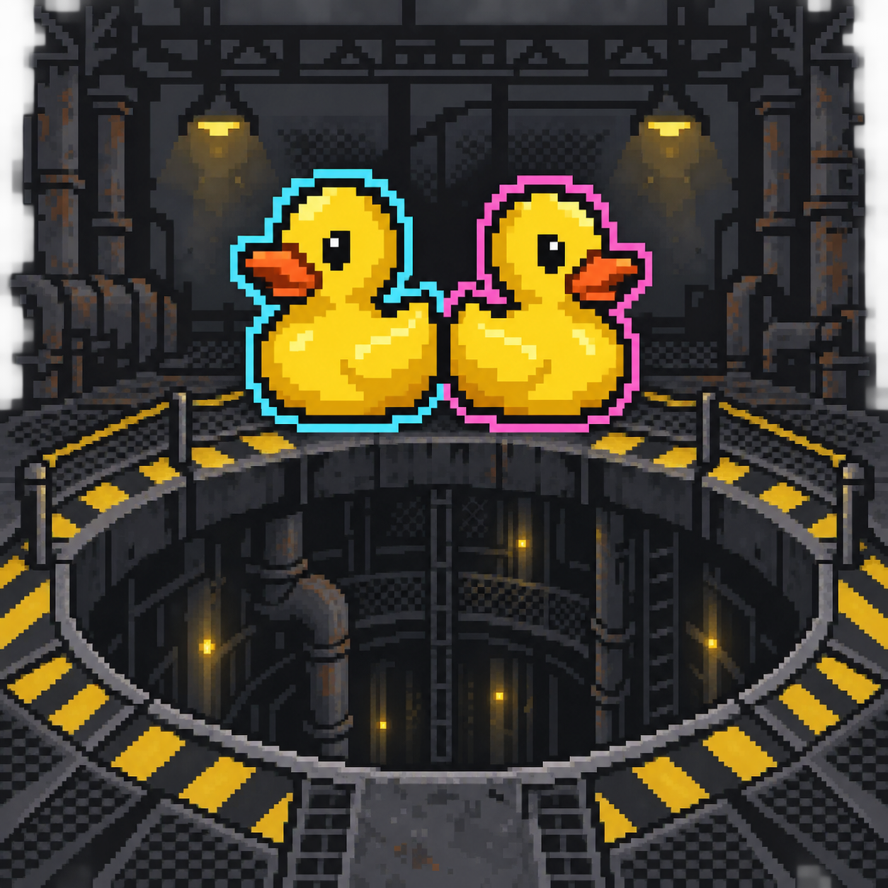

<p align="center"></p>

# Project P.I.T.T. — Unofficial Co-op

An experimental multiplayer mod for **Project P.I.T.T. 1.0.8 on Windows**. Host a shared warehouse for up to four players, with synchronized money, upgrades, machines and customizable crew characters.

**[Download Alpha67](https://github.com/Sunblock-Code/project-pitt-coop/releases/tag/alpha67)** · [Report a bug](https://github.com/Sunblock-Code/project-pitt-coop/issues)

## Install

1. Install your own copy of Project P.I.T.T. **1.0.8** and [Python 3](https://www.python.org/downloads/windows/).
2. Download the **mod-only ZIP** from Releases and extract it into the game folder containing `projectpitt.exe` and `projectpitt.pck`. In Steam: Manage → Browse local files.
3. Run **Install Mod.cmd**. The installer creates a separate `co-op/runtime` folder and leaves the original game files unchanged.
4. Launch **Play Co-op.vbs** (or **Play Co-op.cmd**). This starts the mod without a persistent command window.

Both host and guests must install the same mod version. This installer expects the Windows game files; other game versions are not verified. Keep a backup of any saves you care about. Mod saves/settings use a separate application folder.

## Host and join

- Host: choose **CO-OP / HOST + JOIN** on the start screen and host a lobby. Let friends join before starting the shift.
- Guest: open the co-op menu, enter the host's address and join.
- Same network: use the host PC's local IPv4 address.
- Different networks: the host needs an accessible public IPv4 address, **UDP 27808** forwarded to their PC, and a Windows Firewall allowance. Carrier-grade NAT can prevent direct connections; a shared VPN network is another option.
- Host saves the shared world. Guests receive the host's world state.

## Features and controls

- Shared money, purchases, upgrades and warehouse progression.
- Character name, uniform, headgear and personal holding outline color.
- **F8:** co-op options, host permissions and recovery actions.
- **F5:** third-person view.
- **Hold middle mouse with empty hands:** emote wheel. While carrying an item, middle mouse retains rotation control.
- **M:** hide ducks locally and click through them.
- **Settings → Controls:** personal hold-to-grab (default) or click-to-toggle preference.

The native on-screen prompts describe item-specific controls.

## Alpha67

Nine personal holding colors. Select **CHARACTER → HOLDING COLOR → SAVE CHARACTER**. Other players see your held items in your chosen color; existing profiles default to green.

This remains an **experimental alpha**, not an official multiplayer mode. Heavy physics scenes can slow down the host, and multiplayer edge cases may remain. Local host/guest holding-color, save and release checks passed; this is not a guarantee for every machine, game build or Internet connection.

## Development

Mod code is in `co-op/src`; `co-op/tools/build.py` builds the separate pack from a local game installation. Test scripts are retained for developers and require explicit QA command-line flags. No test captures, saves, logs, personal join shortcuts or game binaries are distributed.

```powershell
python co-op/tools/build.py "C:\Path\To\Project P.I.T.T."
```

Report bugs with both players' mod versions, whether you hosted or joined, reproduction steps, and relevant logs from `co-op/logs`. Review logs for private information before posting.

## Credits

Unofficial fan mod, unaffiliated with the game's developer or publisher. Project P.I.T.T. and its original assets belong to their respective owners. This repository contains no game executable, game pack or game libraries. The custom repository emblem was generated with AI for this mod.
